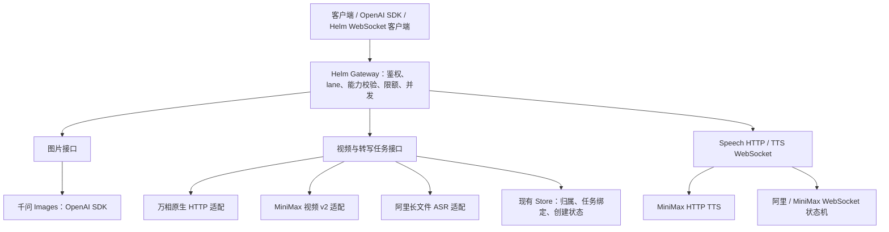

# Helm 多媒体集成方案：三专家联合评审

日期：2026-10-14（Asia/Shanghai）。结论：可行，采用增量接入，不另建媒体网关，不引入 Python/Java 运行服务，不整体重写官方 SDK。

本文件是上一版《阿里与MiniMax接入调研》的实施设计补充；冲突之处以本文件的裁决为准。当前仅完成研究与代码审查，没有实施本批功能、没有收费 API 调用、没有 PR/合并/部署。

## 1. 参与角色与独立结论

| 专家 | 实际模型/推理等级 | 独立研究范围 | 核心结论 |
|---|---|---|---|
| 多媒体架构与协议专家 | gpt-6-astra / high | 图片/视频端口、任务生命周期、配置、存储兼容 | 保留现有图片/视频入口；供应商协议必须显式区分，不能把 Ark 逻辑改名后通用化；先做图片闭环 |
| 实时语音与 SDK 专家 | gpt-6.1-sol / medium | TTS/ASR、SDK源码、单向/双向音频状态机 | 现有 xAI TTS 是完整音频接口；新增同步 speech，再做真正流式及双向；不能声称所有语音协议 OpenAI 兼容 |
| 可靠性、费用与验收专家 | gpt-6-astra / high | P0/P1 归属隔离、重复收费、预算、背压、URL安全 | 必须绑定账户和 endpoint 身份；不明创建结果要可追踪；分别管理三个期限；未知费用不能计作零 |

三位专家均独立只读核对代码和已下载的官方资料。主控负责下述裁决和任务整合。没有将用户密钥发给专家或写入本文。

## 2. 基线与目标

核对的主目录 HEAD：`8ddc30d253afeda43e8930347a9d8b63bab9b62d`。

拟开发基线是已经包含 Ark 集成的独立工作树：

`/Users/lukin/Projects/.worktrees/ark-media-integration/helm-api`

提交：`947b069f3097b65c8085d8535ae0e8bdb7700a0e`，分支 `codex/ark-media-integration`，本次核对时工作树干净。它不是已部署版本的证明。正式开发前再核对远端/分支；若 Ark 尚未合并，新功能基于明确的依赖分支推进，PR 中注明依赖，不重新复制 Ark 实现。

目标是让 Helm 用户通过 lane 调用六类能力：千问图片生成/参考图编辑、万相视频、阿里实时 TTS、阿里非实时 ASR、MiniMax TTS、MiniMax 视频。保留已有 OpenAI、xAI、Ark 客户端及已存在任务的行为。

## 3. 总体结构

边界：shared 定义 Zod schema；core 做框架无关的协议转换、响应校验和流式状态机；gateway 做 Hono 路由、握手与策略执行；配置决定模型、地域、音色和协议。core 不 import Hono/SvelteKit。

不引入“支持所有未来模型”的总框架。只抽取两家新供应商实际共用的任务绑定、生命周期和语音事件接口。

## 4. 对外接口：保留什么、新增什么

以下新增入口为本方案提案，尚未存在于已部署 Helm。

| 能力 | Helm 对外入口 | 上游路径/方式 | 兼容承诺 |
|---|---|---|---|
| 图片生成/参考图编辑 | 保留 `POST /v1/images/generations` | 千问 `/compatible-mode/v1/images/generations` | OpenAI Images 生成核心字段；编辑用 `image` 扩展 |
| 视频 | 保留 `POST /v1/videos/generations`、`GET /v1/videos/{id}` | 万相原生异步；MiniMax v2异步 | 这是现有 Helm 视频契约，不标为完整 OpenAI Videos 兼容 |
| 普通 TTS | 新增 `POST /v1/audio/speech` | MiniMax `/v1/t2a_v2`；后续可复用阿里会话适配 | 支持 `model/input/voice/response_format/speed` 核心字段；返回音频二进制，其他参数按能力校验 |
| 已有 xAI TTS | 保留 `/v1/tts` 及音色入口 | 保持现有 xAI 行为 | 原请求 `text/voice_id` 不强制迁移 |
| 真正双向 TTS | 新增 `WS /v1/audio/tts` | 阿里 inference WS；MiniMax bidi WS | 明确为 Helm 扩展，不冒充 OpenAI Realtime |
| 短音频 ASR | 保留 `POST /v1/chat/completions`，增加专用 ASR lane/profile | `qwen3-asr-flash` Chat 兼容 | `input_audio` 与 `asr_options` 必须完整保留，不进入普通文本 fallback |
| 长文件 ASR | 新增 `POST /v1/audio/transcription-jobs`、`GET /v1/audio/transcription-jobs/{id}` | DashScope transcription + tasks +结果 JSON | 明确异步 JSON URL job；不承诺 Whisper multipart |

普通语音 HTTP 的流式响应与双向输入分开：先支持完整音频；再实现单向输出流；最后支持文本分片输入。音频已经发送后不能通过 HTTP JSON 错误伪装成完整失败：二进制流按约定中断并记录终态；需要结构化错误事件的客户端使用明确的 Helm SSE/WS 扩展。

用户侧模型字段仍是 lane，例如 `image-standard`、`video-standard`、`speech-fast`、`transcription-file`。这些仅为示例，最终沿用项目命名约定；wire model ID 留在配置。

## 5. 供应商与 SDK 选择

### 阿里

- 千问图片使用已安装的官方 OpenAI Node SDK 7.33.0，不增加另一套 SDK。注入现有 `providerFetch` 保留代理、取消、超时和错误处理。SDK 路径还必须通过有界响应读取测试，不得为使用 SDK 丢掉现有大小限制。
- 短音频 `qwen3-asr-flash` 复用现有 OpenAI Chat 兼容链路；若调用 SDK，使用同一个已安装依赖。必测 gateway→IR→provider 对 URL/Data URL、`asr_options`、流式 usage 的保真。
- 万相、长文件 ASR 用现有 HTTP 基础设施。实时 TTS 使用成熟 `ws`；官方 Python/Java SDK 作为行为参考，不做跨进程服务。
- 分离 OpenAI baseURL、原生 API baseURL 和 WebSocket URL。相同业务空间 host 下分别为 `/compatible-mode/v1`、`/api/v1`、`/api-ws/v1/inference`。配置不重复拼接这些路径。
- Qwen-Audio/CosyVoice 和旧 Qwen3 realtime 不能共享一个未经区分的事件解析器。第一批只实现明确的当前 Qwen-Audio/CosyVoice profile；旧 profile 有需求才加入。

### MiniMax

- TTS：原生 `/v1/t2a_v2`；双向 `/ws/v1/t2a_v2_bidi`。视频：`/v2/video_generation` + `/v2/query/video_generation/{task_id}`。
- 当前候选型号：`speech-2.8-hd/turbo`、`MiniMax-H3/H3-Max`，部署前核对账户/地域实际可用性。旧 Hailuo v1 后置，不能静默代替 H3。
- 不使用官方 MCP 包作运行依赖：核对的版本会把未知 TTS 型号降到 `speech-02-hd`，视频只覆盖旧 v1；这与用户指定新模型冲突。仅参考对应源码与官方 OpenAPI/AsyncAPI。
- 国际站文档默认 `api.minimax.io`；密钥所属站点尚未验证，不把密钥逐个发送到不同站点试探。

### 专家分歧的主控裁决

架构专家认为千问图片可直接复用现有 OpenAI HTTP transport，没必要为此额外引入 SDK。用户优先使用官方 SDK，且仓库已安装该依赖，因此决定：新千问适配可复用现有 OpenAI SDK；不迁移其他已稳定 provider；如果 SDK 调用会绕过有界读取等边界，必须先补等价边界验证，而不是盲目替换全局 transport。重点是复用成熟实现、保持行为，不以“用了SDK”代替正确性。

## 6. 必要的代码改动

### A. 明确能力与协议

`mediaOnly` 只能表示“不参与普通文本执行”，不能表示厂商是 Ark。当前 `apps/gateway/src/server.ts:4878` 存在此推断，新增媒体 provider 前必须拆开。

配置添加显式、受校验的媒体 protocol profile，并绑定兼容接口、原生接口及 WebSocket 地址；profile 与 model 能力须匹配。仅增加 YAML 不够：factory 未识别的类型不得落入通用 OpenAI 分支。无需一次重构全局旧 provider 配置，但新媒体配置必须 fail-closed。

core 使用小型适配契约：

- 图片：已校验请求 → wire 请求 → 结果/真实用量。
- 视频/ASR任务：创建结果明确区分 accepted/rejected/unknown；查询规范化状态、产物与用量。
- 语音：完整音频方法与流式 `AsyncIterable` 分开。流式至少区分 started、audio delta、usage、completed、error，含序号、音频格式与采样率。

图片 unsupported 参数不静默丢弃：mask、partial image、标准 multipart edits、上游忽略的 b64_json 等先返回明确错误。参考图数量和尺寸由目标模型校验。

### B. 有限扩展任务存储

先复用现有 registry，不先建独立任务调度平台。新增版本化任务绑定，新写通用记录、双读旧 Ark 编码与旧 xAI 记录；旧 API id 和读回行为保持兼容。

绑定至少包含：Helm操作/任务ID、account/key、kind、lane、provider、wire model、固定上游账户身份、profile、地域/业务空间或endpoint身份、upstream task id、创建状态和必要时间信息。绑定里不保存明文密钥。

查询使用创建时的供应商/账户/profile；配置把同名 provider 改到其他地域/账户时显式拒绝，不能自动转到新配置查询。密钥轮换只在能确认同账户的条件下继续使用旧任务；无法确认时保留任务并说明恢复条件。

创建顺序：持久化操作预约 → 单次请求 → 持久化上游task映射 → 返回Helm任务ID。结果不明时返回可追踪操作ID，不能返回虚假的可查询task ID。已知上游ID应保存在可恢复证据中；响应完全丢失时明确无法查询，不自动创建替代任务。

同一创建路径 SDK/HTTP/route 均不自动重试，不能声称这等于供应商“恰好一次”。如提供 Idempotency-Key，应先持久绑定请求hash与结果，同key重放返回既有结果，冲突拒绝；供应商没有幂等保证时，不自动重发 outcome_unknown。

现有 SQLite/Postgres 数量清理保护需扩展到新增 ASR kind，防止任务被普通 Responses 清理提前删除。

分别记录三个期限：

1. 本地归属/操作记录保留期；
2. 上游任务可查询截止期；
3. 产物链接截止期（未知时保持未知）。

万相查询窗口和输出URL各24小时；MiniMax查询最近7天，URL时限不能臆定24小时，允许按上游协议重新查询刷新。过期不触发重新生成。

### C. 语音必须保留的状态语义

- 阿里：`run-task → task-started → continue-task → finish-task → task-finished`，区分二进制音频和控制帧。连接不得跨账户/密钥代次复用。
- MiniMax HTTP：检查 `base_resp.status_code`；hex 按格式严格解码；设置 `exclude_aggregated_audio:true` 或经过测试的等价去重，避免最终聚合包重复播放。
- MiniMax bidi：request final、sentence end、task finished 分别处理。2205为软背压，仅按文档和有界策略重发被拒的那条输入，不重建会话、不重播已确认文本。
- 统一客户端命令可以包括 start/append/flush/cancel/finish，但每个profile声明能力。不能假设所有厂商都支持取消后续输或同一含义的flush；不支持项显式拒绝，不能靠断开重连偷偷模拟。
- 会话并发租约从准入持续到会话结束；设队列字节/帧上限和慢消费者超时。完成/错误/关闭竞态只释放一次。
- 音频首包后禁止跨供应商切换重播；客户端取消不记作上游故障。

### D. ASR 的范围纠正

前一版“URL-only”表述不够准确：用户指南前文与后文不一致，但后文和详细 API 均有 Base64 Data URL 示例（输入大小限制10MB）。因此将“首期URL输入”定义为工程范围，不再解释为官方不支持Base64。

短ASR先支持URL；Data URL作为同任务的明确后续验收项，若开发成本小可一起覆盖。二者均不可套用普通base64音频的默认格式假设。长ASR需保留每文件成功/失败、文本、时间戳和说话人信息；外层任务成功不代表每个文件成功。

ASR结果需要服务端下载时，复用/有限抽取已有 Gemini 的安全下载设施：逐跳HTTPS、地址校验与DNS连接固定、大小/总时间限制；不向产物域名转发provider Authorization。只把URL返回客户端和服务器主动抓取是两个不同的边界。

## 7. 费用与验收底线

现有预算检查是余额判断，允许单个请求后透支，不是请求级硬金额上限。第一版未知价格/最大成本的媒体调用继续拒绝带硬金额预算的key；不把未知成本计0。

若要开放硬金额预算，再独立实施：原子预留可证明的最大成本、并发余额争抢、终态幂等结算、未确定结果不退款。此能力不作为六类接入先行重构项目。

记录实际供应商用量：图片张数、视频时长或token、TTS计费字符及 `usage_voice_count` 附加声音费用、ASR时长等。首次声线费用可能存在，不能只算文本字符。真实测试只选已确认的系统音色，不创建/克隆声音。

验收层次：

- 单元/契约：Zod、请求映射、真实响应fixture、业务错误、事件顺序。
- 离线集成：Hono→lane→provider mock→Store，跨key/owner、重启、配置漂移、创建不重发、旧记录可读。
- 流式：慢消费者、半开、首音早于完成、首音后断连、结束/关闭竞态、音频不重复、租约不泄漏。
- 文件：图片可解码；视频时长/分辨率/音轨；音频可解码且完整；ASR文本与预设参考内容一致。
- 真调用：实现通过后列出具体模型/地域/音色/输入/次数/估算与无硬上限项，用户确认后执行。已提供密钥不等于批准未列价的新批次。

每个开发任务先红灯测试，再最小实现、绿灯；本机只跑相关 `CI=true` 测试。无UI改动不额外扩展浏览器测试项目。PR要按仓库要求跑完整CI；CI、合并、部署和线上验收分别报告。

## 8. 独立任务与依赖

统一状态枚举：待开始 → 进行中 → 待集成 → 验收通过；失败记录为受阻/需修正并附恢复条件。下表是提案，尚未创建开发聊天或开始改代码。

| ID | 优先级 | 任务 | 依赖 | 可验证完成条件 | 当前状态 |
|---|---|---|---|---|---|
| H00 | P0 | 基线、profile与能力契约 | 无 | 新profile fail-closed；mediaOnly不再推断Ark；旧配置/路由回归通过 | 待开始 |
| H01 | P0 | 千问生成与参考图编辑 | H00 | 目标模型校验；URL结果；unsupported明确拒绝；生成+编辑离线链路 | 待开始 |
| H02 | P0 | 新任务绑定与不明创建结果 | H00 | 旧Ark/xAI双读；operation ID；重启/跨key/配置漂移；崩溃注入无自动重发；SQLite/Postgres均通过 | 待开始 |
| H03 | P0 | 万相3视频 | H02 | 创建→查询→终态；24h窗口；请求与媒体输入映射；失败不报成功 | 待开始 |
| H04 | P0 | MiniMax H3视频 | H02 | v2请求；H3/Max能力区分；7天窗口和URL刷新；不走v1 | 待开始 |
| H05 | P0 | 通用Speech入口与MiniMax普通TTS | H00 | 核心OpenAI字段映射、hex/MIME、业务错误、计量；旧xAI接口不变 | 待开始 |
| H06 | P0 | 阿里短/长ASR | H00、H02 | Chat字段保真；长job持久化、局部失败、结果安全读取；模型能力验证 | 待开始 |
| H07 | P0 | 语音流式基础及阿里实时TTS | H05 | 独立流式端口、首音早于完成、WS握手策略、背压和取消、租约释放 | 待开始 |
| H08 | P1 | MiniMax流式/双向TTS | H07 | 无末包重播；三层完成；软背压；按能力处理flush/cancel | 待开始 |
| H09 | P1 | 主控集成、文档与回归 | H01、H03–H08 | 旧Ark/xAI、双数据库、错误/预算/隔离回归；接口示例与能力清单 | 待开始 |
| H10 | P1 | 经批准的真实调用验收 | H09、具体费用授权 | 每条选定链路有请求摘要、任务ID/终态、产物、实际usage；不重复付费创建 | 待开始 |

这11项替换上一版较粗的A00–A08拆分，避免两套任务重复开工。H00限制为最小可用契约，不等待全部媒体抽象完美才进入H01。

实施顺序：先H00+H01证明一条最小图片链路；随后H02/H05可按隔离范围并行；任务基础稳定后H03/H04/H06可以并行；语音事件接口冻结后H07→H08。主控持有共用schema、配置、任务基础和集成分支；子任务只有明确隔离写范围才开发，避免多人同时改server.ts。

任何阶段都不把SDK“可调用”、HTTP200或任务ID当成生成完成；以终态和实际产物/文本为准。

## 9. 必做与后置

首期必做：六类请求链路、权限与账户隔离、版本化绑定、错误与未知结果、真实流式边界、现有接口兼容、可追踪用量、离线集成和受控真调用。

后置：所有旧模型覆盖、完整OpenAI Realtime模拟、AOQ/WebRTC端侧SDK、图片multipart/mask转换、自动对象存储托管、后台持续轮询、跨供应商付费重试/自动重播、全媒体硬金额预算账本。后置不等于放开安全边界：未实现的明确拒绝。

## 10. 关键审查证据

下列代码路径相对基线工作树；官方快照相对本文目录。专家发现已由主控结合现有代码与资料复核。

| 证据 | 说明 |
|---|---|
| `packages/core/src/provider/openai.ts:176`、`:220`、`:241` | 已有provider能力接口；TTS完整音频与流式需分开 |
| `apps/gateway/src/server.ts:4878` | mediaOnly被用来推断Ark，新增供应商前必须纠正 |
| `apps/gateway/src/routes/videos.ts:469`、`:521`、`:591` | 已有创建预约、映射及任务归属准入基础 |
| `apps/gateway/src/routes/ark-media-task.ts:13`、`:55` | Ark TTL、版本前缀与绑定验证不能盲目通用化 |
| `apps/gateway/src/routes/tts.ts:98`、`apps/gateway/src/server.ts:2095` | 旧TTS固定xAI，应保留兼容再新增lane入口 |
| `packages/core/src/budget/gate.ts:40`、`apps/gateway/src/routes/videos.ts:402` | 预算余额检查与媒体spend-cap拒绝边界 |
| `packages/core/src/provider/gemini.ts:401` | 可复用的安全下载边界参考 |
| `sdk-reference/minimax-tts.ts:217` | MCP旧型号名单/静默换型，不能直接用来支持2.8 |
| `mm-speech-t2a-http.md:513`、`:594` | 字符及声线用量；末包聚合音频 |
| `mm-speech-t2a-websocket-bidi.md:37`、`:82` | 完成层级与2205软背压 |
| `asr-md.md:516`、`qwen-asr-api-reference.md:101` | Base64 Data URL有官方示例，纠正旧报告 |
| `wan3-md.md:653`、`mm-video-generation-v2-query.md:38`、`:330` | 查询窗口、产物URL有效期与刷新不能混为一个TTL |

官方入口：

- [千问图像](https://docs.bailian.console.aliyun.com/zh/model-studio/qwen-image-generation-and-editing-api-reference)
- [万相3](https://docs.bailian.console.aliyun.com/zh/model-studio/wan3-video-generation-api-reference)
- [阿里实时TTS](https://docs.bailian.console.aliyun.com/zh/model-studio/realtime-tts-user-guide)
- [阿里非实时ASR](https://docs.bailian.console.aliyun.com/zh/model-studio/non-realtime-speech-recognition-user-guide)
- [阿里SDK](https://docs.bailian.console.aliyun.com/zh/model-studio/install-sdk)
- [MiniMax HTTP TTS](https://platform.minimax.io/docs/api-reference/speech-t2a-http)
- [MiniMax双向TTS](https://platform.minimax.io/docs/api-reference/speech-t2a-websocket-bidi)
- [MiniMax视频v2](https://platform.minimax.io/docs/api-reference/video-generation-v2-create)
- [MiniMax官方MCP源码](https://github.com/MiniMax-AI/MiniMax-MCP-JS/tree/8032f830203a1c61e56760b1680db923654bcb1b)

源码参考版本：DashScope Python `2aa724a2c02e7c6af9c2a4e82d7f4ccd12885d43`；MiniMax MCP JS `8032f830203a1c61e56760b1680db923654bcb1b`。本次未重新调用账户模型列表，不声称这些候选型号对所提供账户已可用。
